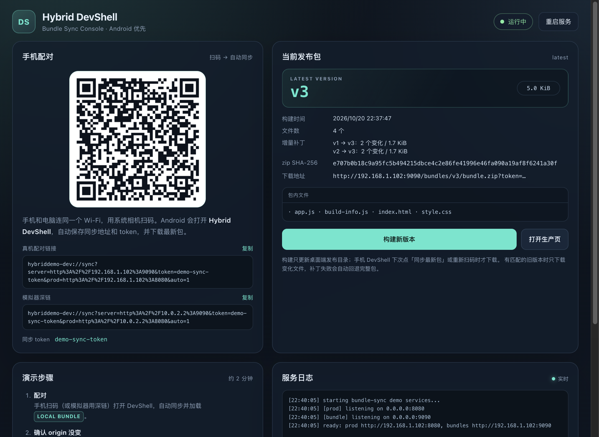
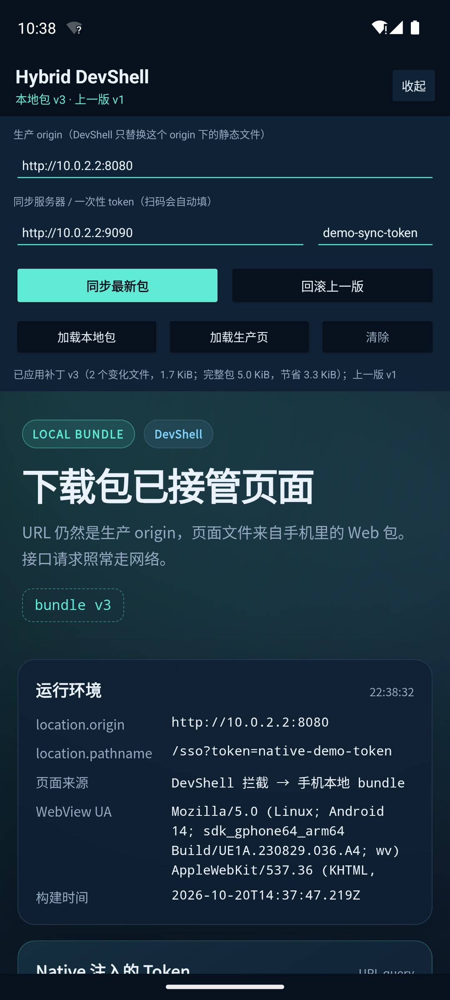
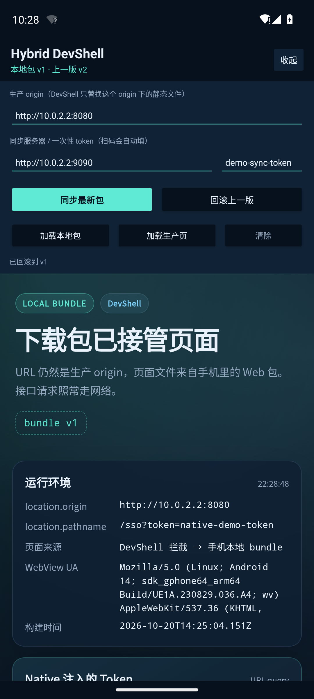
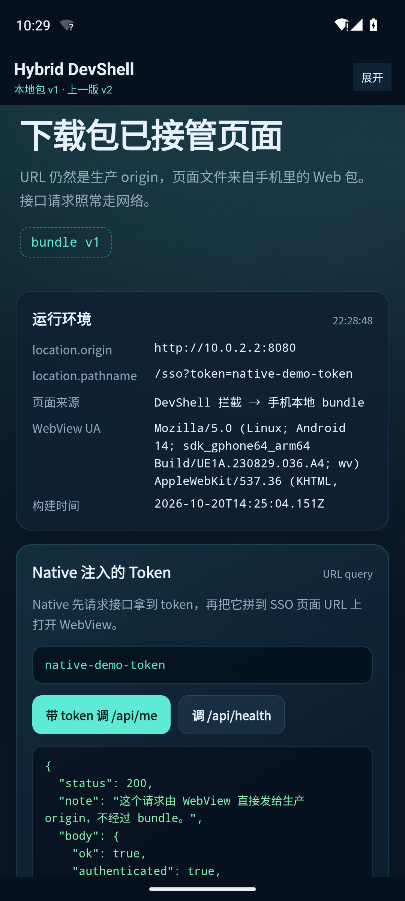
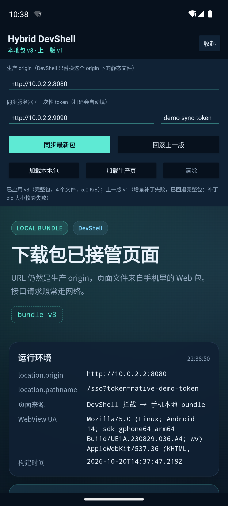
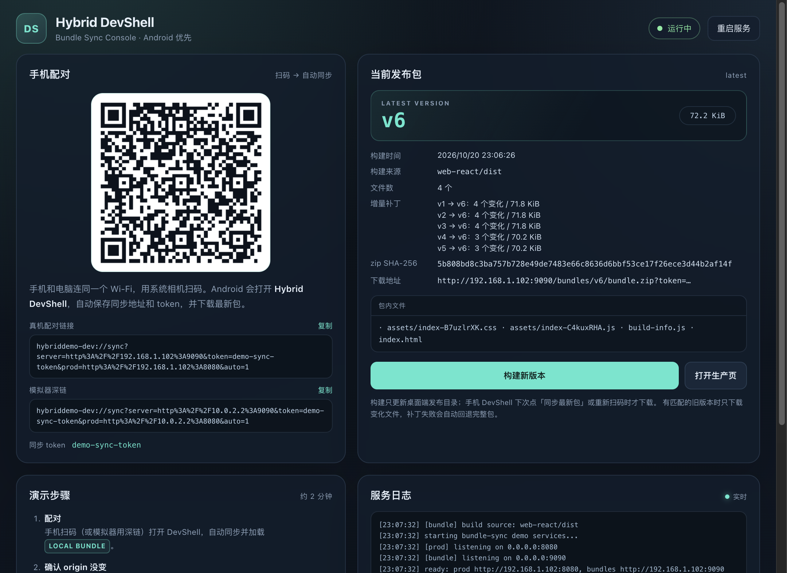
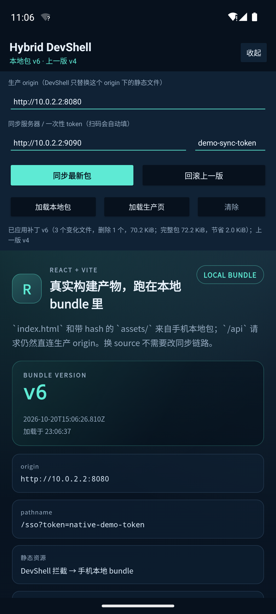
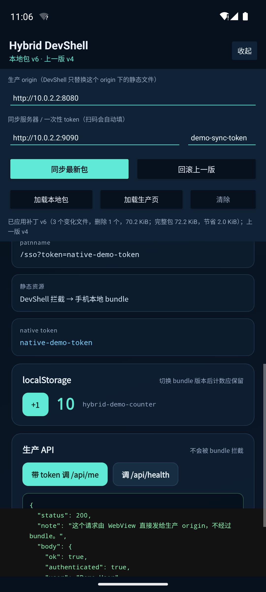
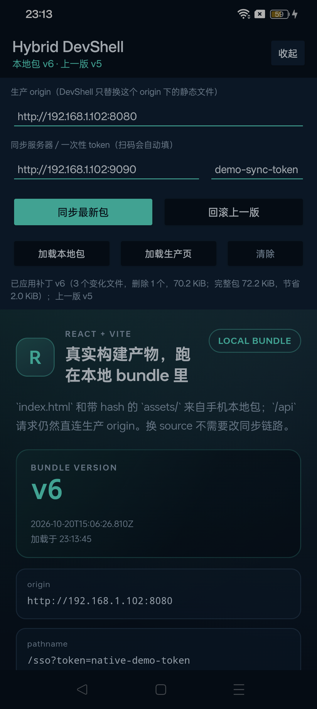
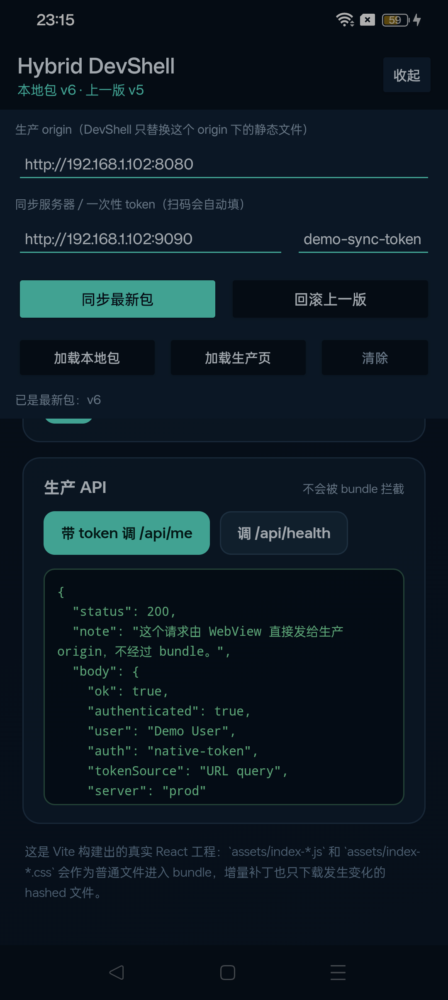

# 签名包同步 Demo（Android）

这个 demo 演示包同步方案：**不重打 Native 包，把 Web 构建产物同步到手机，DevShell 用生产 origin 加载手机本地文件；有旧版本时只下载变化文件。**

它和仓库里原来的代理版 demo 是两条独立链路：

| | 代理版（`npm run desktop`） | 包同步版（`npm run bundle:demo`） |
| --- | --- | --- |
| 手机是否需要配 Wi-Fi 代理 | 需要 | **不需要** |
| 静态资源来源 | 电脑上的 dev server | 手机本地下载的 bundle |
| 是否支持保存即刷新 | 是（整页刷新） | 否（重新构建 + 同步） |
| 同步体积 | 不适用 | 有旧版本时只下载变化文件；无匹配旧版本时下载完整包 |
| 端口 | 8080 / 3000 / 8081 / 8899 | 8080 / 9090 |

两套 demo 都会占用 8080，不能同时运行。

| 桌面控制台 | 手机：本地包 v3（增量补丁） |
| --- | --- |
|  |  |

---

## 1. 快速开始

要求：Node.js 20+、Android SDK（模拟器或真机）、macOS 或 Windows。

```bash
cd demo
npm install

# 首次运行或换 key：生成本地 demo 签名私钥，并更新 pin 的公钥
npm run key:generate

# 桌面控制台（QR 码、配对链接、构建按钮、日志）
npm run bundle:demo

# 或者无界面启动，只打印配对信息
npm run bundle:headless
```

桌面端会自动启动两个服务：

| 服务 | 端口 | 作用 |
| --- | --- | --- |
| mock 生产站点 + API | 8080 | WebView 的 URL 始终落在这个 origin |
| bundle 同步服务 | 9090 | 提供 `latest.json`、`bundle.zip`、`manifest.json`，以及每个旧版本对应的 `patch-from-<version>.zip/json`，需要 token |

首次启动时如果 `dist/latest.json` 不存在，会自动从 `web/bundle` 构建 v1。

不需要手动构建 bundle；在控制台点「构建新版本」即可。也可以单独执行：

```bash
npm run bundle:build    # 只构建，不启动服务
npm run bundle:smoke    # 26 项包格式 / 签名 / 下载 / 增量补丁校验
```

---

## 2. 原理

```
┌──────────────────── 电脑 ────────────────────┐        ┌────────────── 手机 ──────────────┐
│ desktop-bundle (Electron)                     │  LAN   │ DevShell APK                      │
│   :9090  latest.json / bundle.zip / manifest  │ ◄────► │  1. 带 token 拉 latest.json       │
│   :8080  mock 生产页 + /api                    │        │  2. 下载 zip，验 SHA-256          │
│                                               │        │  3. 验 manifest 的 ECDSA 签名      │
│                                               │        │  4. 逐文件验 hash，原子切换版本    │
│                                               │        │  5. WebView 打开生产 URL          │
│                                               │        │     /sso?token=...                │
│                                               │        │  6. 静态资源 → 本地包              │
│                                               │        │     /api 等 → 网络                │
└───────────────────────────────────────────────┘        └───────────────────────────────────┘
```

关键点：

- **URL 不变**。WebView 加载的仍然是 `http://<生产 origin>/sso?token=...`，不是 `file://`，也不是 localhost。Cookie、localStorage、IndexedDB、SSO 回调都还在生产 origin 下。
- **只替换静态文件**。`WebViewClient.shouldInterceptRequest` 判断请求是否命中生产 scheme + authority；命中后才尝试本地 bundle，否则返回 `null` 走网络。
- **接口永远走网络**。`/api`、`/oauth`、`/login`、`/auth` 明确跳过本地包；`/sso` 本身是页面，可以由本地包提供。
- **native token 注入**。Demo 按真实链路模拟：Native 先拿到 token，再把 `?token=native-demo-token` 拼到 SSO 页面 URL 上打开 WebView。页面里的 `/api/me` 用这个 token 发 `Authorization: Bearer`。
- **不需要代理**。手机只访问电脑的 9090 下载包，WebView 的页面和接口直接访问 8080（模拟器是 `10.0.2.2`，真机是电脑局域网 IP）。

Android 端的路由器在
[`LocalBundleWebViewClient.kt`](app-android/web-debug-plugin/src/main/kotlin/com/example/hybriddebug/LocalBundleWebViewClient.kt)：

```kotlin
if (!scheme.equals(prodScheme, ignoreCase = true) ||
    !authority.equals(prodAuthority, ignoreCase = true)) {
    return null // 不是生产 origin，交给 WebView 正常上网
}
if (isNetworkPath(path)) return null // /api、/oauth、/login、/auth
val file = resolve(root, path)
// 命中文件 → 本地返回；SPA 路由 → 回退 index.html；静态资源缺失 → 404
```

---

## 3. 跑 Android DevShell

### 3.1 构建与安装

```bash
cd demo

# DevShell（带同步插件）
npm run android:build
# 产物：app-android/app/build/outputs/apk/devShell/debug/app-devShell-debug.apk

adb install -r app-android/app/build/outputs/apk/devShell/debug/app-devShell-debug.apk
```

包名：`com.example.hybriddemo.devshell`（生产包是 `com.example.hybriddemo`，两者可以共存）。

### 3.2 配对

**模拟器**：桌面控制台里的「模拟器深链」已经使用 `10.0.2.2`，复制后执行：

```bash
adb shell "am start -W -a android.intent.action.VIEW \
  -d 'hybriddemo-dev://sync?server=http%3A%2F%2F10.0.2.2%3A9090&token=demo-sync-token&prod=http%3A%2F%2F10.0.2.2%3A8080&auto=1' \
  -n com.example.hybriddemo.devshell/com.example.hybriddebug.DevShellActivity"
```

> 注意整条远程命令要用双引号包住。否则 `&` 会被 adb shell 当成命令分隔符，Intent 只剩第一个参数。

**真机**：

1. 手机和电脑连同一个 Wi-Fi；
2. 用系统相机扫桌面控制台的二维码。二维码是一个 `http://<电脑IP>:9090/pair?...` 页面，相机打开浏览器后点「打开 Hybrid DevShell」即可（部分浏览器会自动尝试跳转）；
3. 如果相机仍不打开浏览器，或手机没有安装 DevShell，直接打开 App，手动填服务器地址 `http://<电脑IP>:9090`、token `demo-sync-token`、生产 origin `http://<电脑IP>:8080`，再点「同步最新包」。

扫码链接长这样：

```
hybriddemo-dev://sync?server=http%3A%2F%2F192.168.1.102%3A9090&token=demo-sync-token&prod=http%3A%2F%2F192.168.1.102%3A8080&auto=1
```

`auto=1` 表示收到配置后立即检查更新并加载，不用再点按钮。

> 电脑防火墙需要放行 8080 / 9090。macOS 第一次启动 Electron 时如果弹出网络权限，要允许。

### 3.3 验证效果

1. 配对成功后页面顶部显示 **LOCAL BUNDLE** 和 `bundle v1`；
2. `location.origin` 是 `http://<电脑IP>:8080`，`location.pathname` 是 `/sso?token=native-demo-token`；
3. 点「带 token 调 /api/me」，返回 HTTP 200，`authenticated: true`；
4. 点「+1」记下 localStorage 计数；
5. 修改 [`web/bundle/app.js`](web/bundle/app.js) 里的 `BUNDLE_NOTE`；
6. 桌面控制台点「构建新版本」；
7. 手机 DevShell 点「同步最新包」→ 有匹配旧版本时状态显示 `已应用补丁 v2（2 个变化文件，1.7 KiB；完整包 5.0 KiB，节省 3.3 KiB）；上一版 v1`，页面文案变成新的，**localStorage 计数没有丢**；
8. 点「回滚上一版」→ 页面回到 v1，状态显示 `已回滚到 v1`；
9. 如果没有匹配的旧版本（例如刚「清除」过），或补丁下载/校验失败，会显示 `已应用 v2（完整包…）`，并在失败时附带 `增量补丁失败，已回退完整包：…`。

| 回滚到 v1 | token 调生产 API |
| --- | --- |
|  |  |

| 增量补丁成功 | 补丁损坏，自动回退完整包 |
| --- | --- |
|  |  |

「加载本地包 / 加载生产页 / 清除」分别用于：

- **加载本地包**：强制使用当前 active bundle；
- **加载生产页**：同一个生产 URL，但静态资源全部回源到 8080；
- **清除**：删除所有已下载版本，回到生产页。

---

## 4. 包格式与校验

构建器：[`core/bundle-builder.js`](core/bundle-builder.js)。

`manifest.json`：

```json
{
  "format": 1,
  "version": "v2",
  "builtAt": "2026-10-20T14:28:37.864Z",
  "entry": "index.html",
  "files": {
    "app.js": { "size": 1234, "sha256": "..." },
    "index.html": { "size": 567, "sha256": "..." }
  }
}
```

`latest.json` 额外包含 zip 的大小、SHA-256、`keyId` 和 ECDSA 签名。

手机端的安装流程（[`BundleInstaller.kt`](app-android/web-debug-plugin/src/main/kotlin/com/example/hybriddebug/BundleInstaller.kt)）：

1. 带 `Authorization` / token 请求 `latest.json`；
2. 校验格式、`keyId`、版本号、bundle 路径，以及 URL 是否属于同步服务器；
3. 下载 zip，校验大小和整体 SHA-256；
4. 用 DevShell 里 pin 住的 ECDSA P-256 公钥验证 manifest 签名；
5. 校验 manifest 的 version、entry、文件列表；
6. 解压时拒绝路径穿越、重复条目、未知文件和超限大小；
7. 逐文件校验 size 和 SHA-256；
8. 解压到临时目录，完成后原子 rename 成 `versions/<version>`；
9. 原子切换 `active` / `previous` 指针。

文件布局：

```
files/hybrid-debug/active                 # 当前版本号
files/hybrid-debug/previous               # 上一版，用于离线回滚
files/hybrid-debug/versions/<version>/…   # 已校验的文件
files/hybrid-debug/tmp/…                  # 下载/解压临时目录
```

回滚不需要重新下载：交换 `active` 和 `previous` 即可。

### 增量补丁

构建新版本时，构建器会扫描 `dist/bundles` 里保留的每个旧版本，生成一份文件级 patch。`latest.json` 里通过 `patches` 按基础版本索引：

```json
"patches": {
  "v2": {
    "version": "v3",
    "baseVersion": "v2",
    "changed": ["app.js", "build-info.js"],
    "removed": [],
    "manifest": "bundles/v3/patch-from-v2.json",
    "zip": "bundles/v3/patch-from-v2.zip",
    "size": 1756,
    "fullSize": 5129,
    "sha256": "...",
    "keyId": "demo-dev-1",
    "signature": "..."
  }
}
```

补丁 manifest 同样用 ECDSA 签名，里面包含**目标版本的完整文件表**，以及 `changed` / `removed` 列表。这样手机可以只下载变化文件，但仍然能验证最终整棵树：

1. 当前 active 版本等于 `patch.baseVersion` 时才尝试补丁；
2. 下载 `patch-from-<base>.json`，用 pin 住的公钥验签；
3. 校验目标版本、基础版本、entry、`changed` / `removed` 与完整文件表；
4. 下载 patch zip，校验大小和 SHA-256；
5. 把 active 版本里**未变化**的文件复制到 staging；
6. 只从 patch zip 解压 `changed` 里的文件，拒绝未声明、重复、路径穿越的条目；
7. 对 staging 里的**所有目标文件**逐个校验 size 和 SHA-256；
8. 原子切换版本；`removed` 的文件因为不会被复制，自然消失。

任何一步失败（没有匹配补丁、下载失败、签名/hash 不对、基础版本文件损坏等），都会自动回退到完整包重新安装。完整包仍然走原来的签名 + 逐文件校验流程，所以回退不会降低安全性。

实测 v2 → v3 只改 `app.js` 时：

- 完整包：5.0 KiB；
- 增量补丁：1.7 KiB（含 `app.js` 和新版 `build-info.js`）；
- 节省约 3.3 KiB。

> 这是**文件级增量**，不是二进制 diff。`app.js` 改一行仍然要下载整个 `app.js`（压缩后）。后续可以在文件级之上再加 bsdiff/xdelta，进一步缩小大文件的变化体积。

### 用真实 React + Vite 工程作为 source

[`web-react/`](web-react) 是一个最小的 React + Vite 工程，用来验证真实构建产物不需要改同步链路。

```bash
npm run react:install      # 首次安装 web-react 的依赖
npm run react:build        # vite build → web-react/dist
npm run bundle:build:react # 从 web-react/dist 构建一个新 bundle 版本

# 让桌面控制台的「构建新版本」也使用 React 产物
npm run bundle:demo:react
```

`--source` 相对于 `demo/` 解析，也可以指向任意工程：

```bash
node core/bundle-builder.js --source ../your-app/dist
electron desktop-bundle/main.js --source ../your-app/dist
```

控制台的「构建来源」会显示当前 source。Vite 产物直接进入 bundle：

| bundle 内文件 | 来源 |
| --- | --- |
| `index.html` | Vite 构建输出 |
| `assets/index-<hash>.js` | React 运行时 + 业务代码（原始 226.7 kB） |
| `assets/index-<hash>.css` | 样式 |
| `build-info.js` | bundle 构建器注入（源目录里的同名占位文件会被跳过） |

实测从 v4 切到 React 构建的 v6：

- 完整包 72.2 KiB（Vite 产物压缩进 zip 后）；
- 补丁 70.2 KiB（3 个文件变化，删除 1 个旧 hash 的 JS）；
- 手机上显示 `已应用补丁 v6（3 个变化文件，删除 1 个，70.2 KiB；完整包 72.2 KiB，节省 2.0 KiB）；上一版 v4`；
- 页面 `location.origin` 仍是 `http://10.0.2.2:8080`，localStorage 计数保留为 10；
- `/api/me` 仍返回 200（`authenticated: true`）。

| 桌面控制台：source = `web-react/dist` | 手机：React 构建产物 |
| --- | --- |
|  |  |



真机（OPPO Android 14）上同样直接加载：



真机上的 `/api/me` 也返回 200：



> Vite 的 hashed 文件名每次构建都会变，补丁会把旧 hash 文件记为删除、新 hash 文件记为新增；这是文件级补丁的正常行为。真实工程可以固定入口文件名，或者接受这个体积开销。

### 签名 key

仓库只提交公钥，签名私钥在本地生成，不会进入 Git：

```bash
cd demo
npm run key:generate
```

脚本会生成 `dev-keys/bundle-signing-key.pem`（已 gitignore）、更新公钥文件，并同步修改
[`DevShellConfig.kt`](app-android/web-debug-plugin/src/main/kotlin/com/example/hybriddebug/DevShellConfig.kt)
里 pin 的 `BUNDLE_PUBLIC_KEY_BASE64`。生成后需要重新构建 DevShell APK。

真实环境应把私钥放在 CI / KMS，由发布流水线签名；DevShell 只内置公钥。详见 [`dev-keys/README.md`](dev-keys/README.md)。

---

## 5. 生产包隔离

Android 工程用 product flavor 隔离：

```groovy
productFlavors {
    production { dimension "shell" }
    devShell {
        dimension "shell"
        applicationIdSuffix ".devshell"
        versionNameSuffix "-devshell"
    }
}
dependencies {
    devShellImplementation project(":web-debug-plugin")
}
```

- `production` 不依赖 `web-debug-plugin`，没有 `DevShellActivity`、拦截器、同步逻辑和 pin 的公钥；
- `devShell` 才包含插件，并且单独包名，不会覆盖生产包；
- DevShell 的 `main` Activity 在 `src/devShell/AndroidManifest.xml` 里被禁用，启动器只显示 DevShell。

构建并检查：

```bash
npm run android:build:production
APK=app-android/app/build/outputs/apk/production/debug/app-production-debug.apk

# 应该输出 0
unzip -p "$APK" 'classes*.dex' | strings | grep -c 'com/example/hybriddebug'
```

本 demo 实测（Kotlin 2.1.0，debug 构建）：

- production APK 799K，`classes.dex` / `classes2.dex` 中插件相关标记为 **0**；
- devShell APK 841K，dex 中存在插件类引用；
- 两者都比 Java 版大约 0.7 MB，主要是 Kotlin 标准库；真实流水线可对 release 包开启 R8/混淆来收缩体积。

> 这个 demo 的两个 flavor 都是 debug build，方便直接安装。真实流水线应产出 devShell flavor 的 **release** 变体，用公司内部签名分发；production flavor 的 release 包保持原样。

---

## 6. 已验证内容

- `npm run bundle:smoke`：26/26 通过（token 鉴权、latest、zip 大小/SHA-256、签名、逐文件 hash、注入的 build-info、路径穿越、错误 token、补丁文件表/签名/体积，以及用 v1 + patch 重建 v2 全量文件树）。
- Android 构建：Kotlin 2.1.0，`npm run android:build:all` 成功，production / devShell 两个 APK 均产出。
- Android 模拟器（Kotlin DevShell）：安装新 APK → 深链配对 → 从 v4 应用补丁到 React v6 → 页面显示 **REACT + VITE** / `bundle v6`，`/api/me` 返回 200，localStorage 计数 10 保留。
- 补丁成功路径（Kotlin 客户端）：`已应用补丁 v6（3 个变化文件，删除 1 个，70.2 KiB；完整包 72.2 KiB，节省 2.0 KiB）；上一版 v4`。
- 扫码 / 深链 `auto=1`：收到配置后自动检查更新（日志 `正在检查更新… → 已应用补丁… → load /sso local=true version=v6`）。
- same-origin：页面 `location.origin` 始终是 `http://10.0.2.2:8080`，localStorage 计数跨版本保留。
- native token：`/api/me` 带 `Authorization: Bearer native-demo-token` 返回 200，证明 API 没有被本地包拦截。
- 生产包隔离：production APK 中不存在 `com.example.hybriddebug`。
- 真机（OPPO，Android 14，与电脑同一 Wi-Fi）：安装 Kotlin DevShell APK → 深链配对 → 从 v5 应用补丁到 React v6 → 页面加载，`/api/me` 返回 200（`auth: native-token`、`tokenSource: URL query`）。
- 扫码链路：系统相机 → `http://<电脑IP>:9090/pair?...` 配对页 →「打开 Hybrid DevShell」→ App 收到完整 server/token/prod/auto 参数并自动同步。

---

## 7. 这一版还没有什么

- **没有 HMR**。补丁是文件级增量，仍然需要「构建 + 同步」，不是保存即刷新；也没有二进制 diff（bsdiff/xdelta）。
- **没有集成 Web 构建命令**。React source 需要先 `npm run react:build`，控制台只负责打包 bundle；真实方案应把 `vite build` / `webpack` 等命令接进桌面端或编辑器插件。
- **补丁按保留的旧版本全量生成**。Demo 每次构建会给 `dist/bundles` 里的每个旧版本生成一份 patch；版本多了会浪费磁盘和构建时间。真实方案应按需生成、限制保留数量，或只保留最近 N 个基础版本。
- **没有断点调试**。按当前规划，调试先放弃。
- **没有 iOS 包同步**。本 demo 只做 Android；iOS 仍走原代理 demo 或后续方案。
- **自定义 scheme 二维码兼容性有限**。部分相机 App 不会直接打开 `hybriddemo-dev://`；现在二维码改用 HTTP 配对页 `/pair`，由浏览器再跳转 custom scheme，部分浏览器仍可能要求手动点按钮。相机完全不支持扫码打开网页时，仍需手填配置。
- **同步服务只有一次性 token，没有 TLS**。仅限内网 demo；真实方案需要 HTTPS、短期 token、审计和限流。
- **DevShell 是 debug 包**。真实交付应由流水线构建 devShell release 包，前端开发不需要跑 Android 工程。
- **token 目前在 URL 里**。这符合当前 SSO 的传参方式，日志里也刻意不打印完整 URL；真实 token 应是短期、一次性的。

---

## 8. 关键文件

| 文件 | 作用 |
| --- | --- |
| [`core/bundle-builder.js`](core/bundle-builder.js) | 构建 manifest、zip、增量补丁、签名和 latest.json |
| [`core/bundle-server.js`](core/bundle-server.js) | 带 token 的 LAN 包服务器（完整包 + patch） |
| [`core/bundle-orchestrator.js`](core/bundle-orchestrator.js) | 启停 8080 / 9090，生成配对链接 |
| [`desktop-bundle/main.js`](desktop-bundle/main.js) | Electron 控制台主进程 |
| [`desktop-bundle/renderer/app.js`](desktop-bundle/renderer/app.js) | 控制台 UI：QR、状态、补丁信息、构建、日志 |
| [`scripts/bundle-smoke.js`](scripts/bundle-smoke.js) | 26 项包与补丁校验测试 |
| [`web/bundle/app.js`](web/bundle/app.js) | 手机页面；改 `BUNDLE_NOTE` 体验版本更新 |
| [`web-react/`](web-react) | 可切换的 React + Vite source，验证真实构建产物 |
| [`web-debug-plugin/.../DevShellActivity.kt`](app-android/web-debug-plugin/src/main/kotlin/com/example/hybriddebug/DevShellActivity.kt) | DevShell UI、配对、同步、回滚 |
| [`web-debug-plugin/.../BundleInstaller.kt`](app-android/web-debug-plugin/src/main/kotlin/com/example/hybriddebug/BundleInstaller.kt) | 下载、验签、校验、安装 |
| [`web-debug-plugin/.../BundleStore.kt`](app-android/web-debug-plugin/src/main/kotlin/com/example/hybriddebug/BundleStore.kt) | 版本目录与 active/previous 指针 |
| [`web-debug-plugin/.../LocalBundleWebViewClient.kt`](app-android/web-debug-plugin/src/main/kotlin/com/example/hybriddebug/LocalBundleWebViewClient.kt) | 生产 origin 静态资源拦截 |
| [`web-debug-plugin/.../DevShellConfig.kt`](app-android/web-debug-plugin/src/main/kotlin/com/example/hybriddebug/DevShellConfig.kt) | 演示配置与 pin 的签名公钥 |
| [`app/.../MainActivity.kt`](app-android/app/src/main/kotlin/com/example/hybriddemo/MainActivity.kt) | 生产 WebView 壳（Kotlin） |
| [`dev-keys/README.md`](dev-keys/README.md) | demo 签名 key 的生成与安全说明 |
