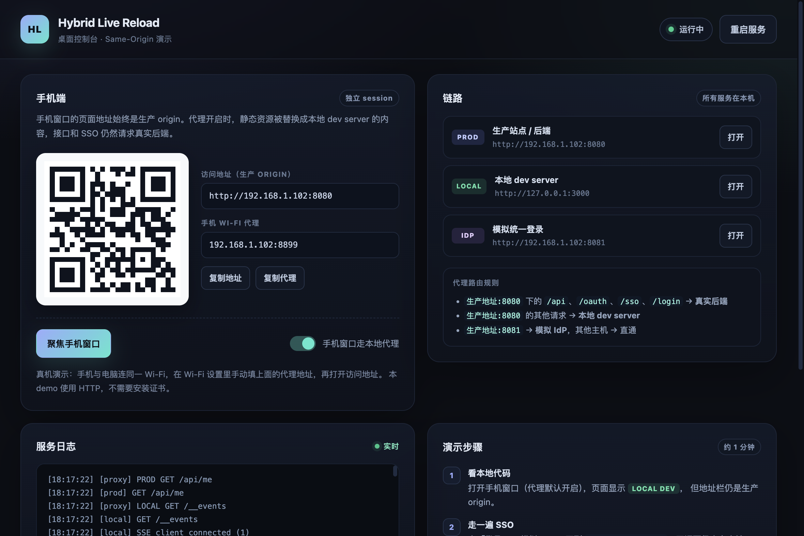
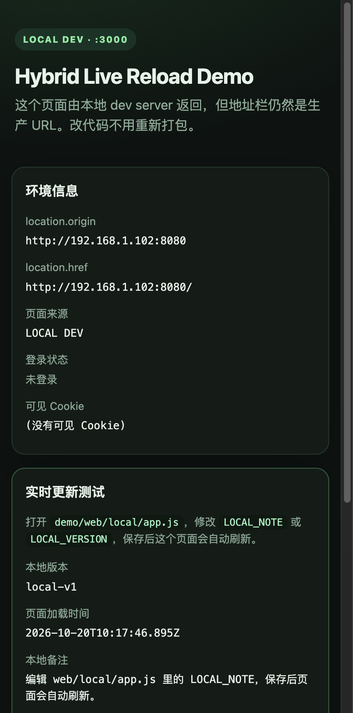
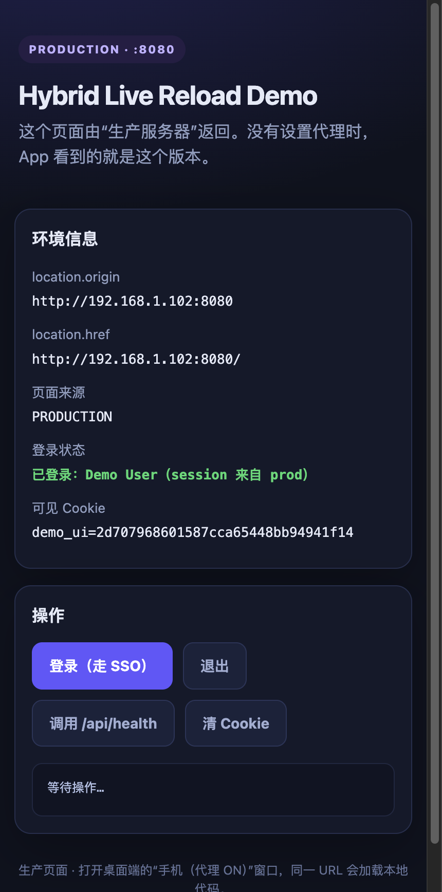
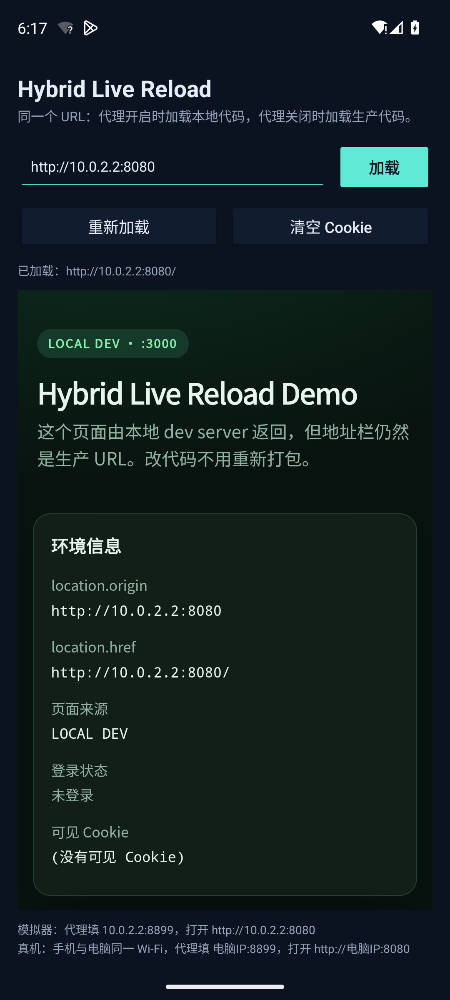
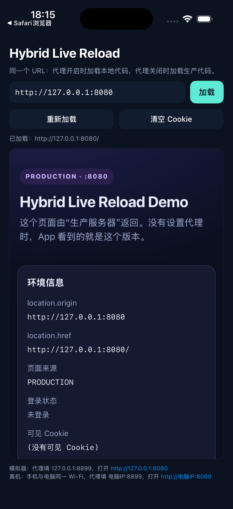

# Hybrid Live Reload Demo

一个可运行的 same-origin 混合开发 demo：**手机 App 里仍然是生产 URL，但页面内容可以来自本地 dev server**。

它的用途是验证两件事：

1. 改 Web 代码后，手机上的 App 直接刷新就能看到效果，不用重新打 Web 包、也不用重新打 Native 包。
2. SSO 登录态不会因为切换本地/生产代码而丢失，因为 origin 始终没变。

> 这是用于演示原理的工程，不是生产实现。真实方案（HTTPS + Whistle + VSCode 插件/桌面端）见 [`../SELECTION.md`](../SELECTION.md)。

> **另一个 demo：包同步 + 增量补丁。** 不配 Wi-Fi 代理，手机经自定义 TCP 从电脑下载带 SHA-256 校验的 Web 包（同一端口还提供 HTTP 配对页）；有旧版本时只下载变化的文件，补丁失败自动回退完整包。TCP 通道是持久双向的：支持并发请求 ID、客户端 `PUT` 上传、服务端 `EVENT` 推送和心跳，构建新版本后手机可以自动同步。仍然用生产 origin 加载本地文件。构建 source 可以是纯静态目录，也可以切换到真实的 React + Vite 工程（[`web-react/`](web-react)）。见 [`BUNDLE_SYNC.md`](BUNDLE_SYNC.md)。



| 手机窗口：本地代码，生产 origin | 切回生产，登录态还在 |
| --- | --- |
|  |  |

| Android 模拟器 | iOS 模拟器 |
| --- | --- |
|  |  |

---

## 1. 快速开始

要求：Node.js 20+（本工程在 Node 26 上验证）。

```bash
cd demo
npm install
npm run desktop
```

桌面控制台会自动启动所有服务，点「打开手机窗口」即可。

其他入口：

```bash
npm run headless   # 无界面启动，只打印手机 URL / 代理地址，适合真机
npm run smoke      # 无界面跑 10 项 same-origin / SSO 检查
```

> `desktop`、`headless`、`smoke` 会占用同一组端口，同时只能跑一个。跑 `smoke` 前先关掉桌面端。

端口分配（可在 `core/config.js` 修改）：

| 服务 | 端口 | 作用 |
| --- | --- | --- |
| 生产站点/后端 | 8080 | 模拟已发布的 Web 与 API |
| 本地 dev server | 3000 | 提供本地代码 |
| 模拟 IdP | 8081 | 模拟企业统一登录 |
| HTTP 代理 | 8899 | 决定请求走本地还是生产 |

---

## 2. 它到底怎么工作

```
手机 WebView
  URL 永远是 http://<电脑IP>:8080
            │
            ▼
      本地 HTTP 代理 :8899
            ├── :8080 的 /api /oauth /sso /login  → 生产服务 :8080
            ├── :8080 的其他请求                  → 本地 dev server :3000
            ├── :8081                             → 假 IdP :8081
            └── 其他 host                         → 原样直通
```

关键点：

- **不跳转 localhost**。WebView 的地址始终是生产 origin，Cookie、`redirect_uri`、localStorage、SSO 回调都绑定在同一个 origin 上。
- **只替换静态资源**。HTML/JS/CSS 来自本地，接口和登录仍然请求真实后端。
- **代理只做一个转发决策**。关闭代理后，同一个 URL 会直接命中生产服务，登录态仍然有效。

代理核心逻辑在 [`core/proxy.js`](core/proxy.js)，路由规则很短：

```js
if (own && port === prodPort) {
  isApi ? PROD : LOCAL;
} else if (own && port === idpPort) {
  IDP;
} else {
  PASS;
}
```

---

## 3. 桌面端演示步骤（约 1 分钟）

1. 启动 `npm run desktop`，服务自动运行。
2. 点「打开手机窗口」。代理默认开启，页面显示 **LOCAL DEV**，但地址栏是 `http://<电脑IP>:8080`。
3. 点页面里的「登录（走 SSO）」：
   - 跳转到本地假 IdP（`:8081`）；
   - 点「以 Demo User 登录」；
   - 回到 `/callback?code=...`，回调页仍然来自本地代码；
   - `/oauth/token` 透传到生产后端，Cookie 写在生产 origin 下。
4. 在控制台关闭「手机窗口走本地代理」，手机窗口自动刷新：
   - 页面变为 **PRODUCTION**；
   - 登录状态仍然是 `已登录：Demo User`。
5. 重新打开代理，手机又回到本地代码，登录态仍然在。
6. 编辑 [`web/local/app.js`](web/local/app.js) 里的 `LOCAL_NOTE` 或 `LOCAL_VERSION` 并保存，手机页面会自动刷新。
7. 「清空登录态 / Cookie」会同时清理手机 session 和服务端内存 session。

手机窗口是 Electron 里独立的 `persist:hybrid-demo-phone` session，代理通过 `session.setProxy()` 开关，模拟真实手机上的代理行为。

---

## 4. Android demo

### 构建

```bash
cd demo
npm run android:build:production
# 产物：app-android/app/build/outputs/apk/production/debug/app-production-debug.apk
```

> `npm run android:build` 现在构建的是包同步 demo 的 DevShell flavor，见 [`BUNDLE_SYNC.md`](BUNDLE_SYNC.md)。本文的代理版 demo 用 `production` flavor。

也可以直接：

```bash
cd demo/app-android
./gradlew assembleProductionDebug
```

### 在模拟器里跑

模拟器访问电脑用 `10.0.2.2`。代理指向 `10.0.2.2:8899`：

```bash
adb install -r app-android/app/build/outputs/apk/production/debug/app-production-debug.apk
adb shell settings put global http_proxy 10.0.2.2:8899
adb shell am start -n com.example.hybriddemo/.MainActivity
```

App 默认 URL 是 `http://10.0.2.2:8080`。代理开启时应该看到 **LOCAL DEV**，地址仍然是 `http://10.0.2.2:8080`。

清理代理：

```bash
adb shell settings put global http_proxy :0
```

> 有些 Play Store 模拟器镜像第一次启动时 WebView 未启用，表现为崩溃日志
> `Failed to load WebView provider: No WebView installed`。执行一次：
>
> ```bash
> adb shell pm install-existing --user 0 com.google.android.webview
> ```
>
> 这是镜像问题，不是 App 代码问题。

### 真机

1. 手机和电脑连同一个 Wi-Fi。
2. 手机 Wi-Fi 设置里配置 HTTP 代理：`<电脑局域网IP>:8899`。
3. App 地址改成 `http://<电脑局域网IP>:8080`。

电脑的局域网 IP 会在桌面控制台 / `npm run headless` 的输出里显示。

---

## 5. 包同步 demo：自定义 TCP

这条链路不配 Wi-Fi 代理。电脑在 `9090` 上同时提供两件事：

- 自定义二进制 TCP 协议：DevShell 用它下载 `latest.json`、完整包和增量补丁，也支持上传、消息和服务端推送；
- 普通 HTTP：只提供 `/pair` 配对页和 `/health` 健康检查，**不通过 HTTP 暴露 bundle 数据**。

### 5.1 为什么用自定义 TCP

Android 的明文策略（`usesCleartextTraffic` / `network_security_config.xml`）由 HTTP 栈和 WebView 执行，例如 `HttpURLConnection`、OkHttp、WebView 的网络请求。`java.net.Socket` 是原始 TCP，不经过 `NetworkSecurityPolicy`，所以即使把 `usesCleartextTraffic` 设为 `false`，自定义 TCP 同步仍然可以工作。

协议 v2 时期的实测结果（v3 仍走同一条原生 `Socket` 路径，但没有在 cleartext 关闭的 APK 上重跑）：

- `usesCleartextTraffic="false"` 时，WebView 打开生产页报 `net::ERR_CLEARTEXT_NOT_PERMITTED`；
- 同一个 APK 通过自定义 TCP 完成 `latest.json`、`bundle.zip` 下载和校验，成功应用 bundle v3 / v4。

注意这只是绕过了**策略**，没有解决**安全**：TCP 上仍然是明文，也没有鉴权。SHA-256 只保证完整性，不提供机密性。仅限内网开发环境；真实方案需要在 TCP 之上加 TLS（或 VPN / mTLS），并配访问控制、审计和限流。

### 5.2 启动、端口与配对

```bash
cd demo
npm run bundle:demo       # Electron 控制台
npm run bundle:headless   # 无界面，只打印配对信息
npm run bundle:smoke      # 56 项自定义 TCP / bundle / patch 检查
```

| 端口 | 协议 | 作用 |
| --- | --- | --- |
| 8080 | HTTP | mock 生产站点和 API，WebView 的 origin |
| 9090 | 自定义 TCP + HTTP | bundle 下载、上传、消息和推送走 TCP；`/pair`、`/health` 走 HTTP |

配对深链不再需要 token：

```text
hybriddemo-dev://sync?server=tcp%3A%2F%2F10.0.2.2%3A9090&prod=http%3A%2F%2F10.0.2.2%3A8080&auto=1
```

也可以手动填写 `tcp://<电脑IP>:9090`。系统相机扫到的 HTTP 配对页是：

```text
http://<电脑IP>:9090/pair?server=tcp%3A%2F%2F<电脑IP>%3A9090&prod=http%3A%2F%2F<电脑IP>%3A8080&auto=1
```

配对页只把 `server`、`prod`、`auto` 三个参数转成深链，不会携带 token。`/health` 可以确认当前传输方式：

```bash
curl http://127.0.0.1:9090/health
# {"ok":true,"service":"bundle-server","transport":"custom-tcp","protocol":3,...}
```

### 5.3 同一端口复用

`core/bundle-server.js` 只监听一个 `net.Server`：

1. 先偷看连接的前 4 个字节；
2. 等于 `HBT1` → 交给自定义 TCP 处理器；
3. 其他 → 把同一个 socket 交给内部的 HTTP server，只响应 `/pair` 和 `/health`。

因此 bundle 数据永远不会通过 HTTP 返回；对 `http://...:9090/latest.json` 的请求是 404。

TCP 连接建立后是**持久、全双工**的：客户端先发 `HELLO`，之后可以在同一条连接上并发发送 `GET` / `PUT` / `MESSAGE` / `SUBSCRIBE` / `PING`；服务端可以随时返回 `RESPONSE`、回显 `MESSAGE`、推送 `EVENT` 或发送 `PING`。响应用 `requestId` 关联，可以乱序到达。只有 `CLOSE` 或协议错误会关闭连接。

> 模拟器 NAT 有一个坑：如果服务端写完最后一帧立刻发 FIN，偶尔会丢掉最后一个字节。关闭路径仍然保留“写回调后延迟 50 ms 再 `end()`”的处理；正常同步连接不再每请求关闭。

### 5.4 线协议

实现位于 [`core/bundle-protocol.js`](core/bundle-protocol.js)，Android 端对应 [`BundleTcpClient.kt`](app-android/web-debug-plugin/src/main/kotlin/com/example/hybriddebug/BundleTcpClient.kt)。

#### 帧头（两个方向相同）

```text
偏移  长度  字段
0     4     magic：客户端 → 服务端 "HBT1"，服务端 → 客户端 "HBR1"
4     1     version = 3
5     1     type
6     1     flags = 0
7     1     reserved = 0
8     4     requestId，大端 u32
12    4     payloadLen，大端 u32
16    ...   payload
```

- `requestId` 用来关联请求和响应，允许同一条连接上多个请求同时在途、响应乱序返回；`0` 保留给服务端主动发送的 `EVENT` 和心跳。
- 多个帧可以在一次 `write` 里连续发送；解析器会缓存不完整帧。与 v2 不同，第一帧之后的多余字节属于下一帧，不再视为尾随错误。
- 未知版本、类型、非零 `flags` / `reserved` 或超限帧会收到 `ERROR` 帧，随后连接关闭；超大 `MESSAGE` 返回 `ERROR`，但连接保留。
- **没有 token 字段，也没有任何鉴权字段**。协议 v3 与 v2 不兼容，旧客户端会收到版本错误。

#### 帧类型

| type | 名称 | 方向 | payload |
| --- | --- | --- | --- |
| 1 | HELLO | C → S | JSON：`{client, protocol, capabilities}` |
| 2 | WELCOME | S → C | JSON：`{server, protocol, heartbeatMs, maxPayloadBytes, maxUploadBytes, capabilities}` |
| 3 | GET | C → S | path（UTF-8） |
| 4 | RESPONSE | S → C | `status u8 \| reserved u8 \| SHA-256(body) 32 \| body` |
| 5 | PUT | C → S | `pathLen u16 \| path \| SHA-256(body) 32 \| body` |
| 6 | MESSAGE | 双向 | 任意字节；demo 服务端原样回显 |
| 7 | EVENT | S → C | JSON：`{event, data, at}` |
| 8 | SUBSCRIBE | C → S | JSON：`{events: ["bundle-changed", ...]}` |
| 9 / 10 | PING / PONG | 双向 | 8 字节时间戳；PONG 原样回显 |
| 11 | ERROR | 双向 | JSON：`{ok:false, error, message?}` |
| 12 | CLOSE | 双向 | 空 |

`RESPONSE` 和 `PUT` 的 body 都带 SHA-256；客户端先校验 checksum，再解析 JSON、写 zip 或落盘。错误响应 body 是 JSON，例如 `{"ok":false,"error":"not_found"}`。

#### GET / PUT / 事件

允许 `GET` 的路径：

```text
/latest.json
/bundles/<version>/bundle.zip
/bundles/<version>/manifest.json
/bundles/<version>/patch-from-<version>.zip
/bundles/<version>/patch-from-<version>.json
/uploads/...            # PUT 写入后可通过 GET 读回
```

`<version>` 段只允许 `[A-Za-z0-9._-]`，解析后还会检查文件必须落在 `dist/bundles` 目录内，防止路径穿越。

`PUT` 只接受 `/uploads/...`：path 不能为空、不能含 `..` / 反斜杠 / NUL，服务端先写同目录临时文件再原子替换。上传成功会返回 `{ok, path, size, sha256}`，并给订阅了 `upload` 的连接推送事件。

`SUBSCRIBE` 支持的事件：

- `bundle-changed`：服务端每 500 ms 检查 `latest.json`，版本 SHA-256 变化时推送 `{version, sha256, size}`；
- `upload`：任意客户端 `PUT` 成功后推送 `{path, size, sha256}`。

状态码：

| status | 名称 | 含义 |
| --- | --- | --- |
| 0 | OK | 成功，body 是文件内容或 JSON |
| 1 | BAD_REQUEST | path 不合法、PUT 格式或订阅参数错误 |
| 2 | NOT_FOUND | 路径不在白名单，或文件不存在 |
| 3 | TOO_LARGE | 响应或上传超过限制 |
| 4 | SERVER_ERROR | 服务端读取 / 写入失败等内部错误 |

#### 心跳、限制与超时

- 服务端在收到 `HELLO` 后每 15 秒发一次 `PING`，45 秒收不到 `PONG` 就断开；socket 空闲超时 60 秒。
- Android 客户端在 reader 线程自动回 `PONG`；读取超时取 `max(heartbeat × 3, 45 秒)`，连接超时 8 秒，普通请求 30 秒，下载 120 秒。
- Node 客户端连接超时 8 秒、普通请求 10 秒，并维护心跳看门狗。
- 单帧 payload 上限 128 MiB；GET 响应上限 128 MiB；PUT 上限 64 MiB；MESSAGE 上限 1 MiB；控制 JSON / 事件上限 64 KiB；path 上限 4096 字节。
- 服务端会把整个 GET 文件读入内存后再发一个帧；Android `download()` 把响应 body 直接流式写入文件并边写边算 SHA-256，避免整包驻留内存。当前没有分块传输或断点续传。
- 连接断开后没有自动重连 / 退避；实时通道断开后需要重新点「实时通道」。同步本身每次新开一条短会话，完成或失败后 `CLOSE`。

### 5.5 同步流程

1. 深链或手填地址得到 `tcp://host:port`，地址和帧里都不含 token；
2. 建立原生 `Socket` 连接，先发 `HELLO`（`client`、`protocol: 3`），收到 `WELCOME` 后开始请求；同一条连接上可以并发多个带 `requestId` 的请求；
3. `GET /latest.json`，校验帧格式、版本号和 `RESPONSE` 里的 SHA-256；
4. 如果当前 active 版本在 `patches` 里有匹配项，先 `GET` `patch-from-<base>.json` 和 patch zip；
5. 没有补丁、补丁校验失败或安装失败时，自动回退 `GET` 完整 `bundle.zip`；
6. 下载时校验 `latest.json` / manifest 里声明的 size 和 SHA-256；Android 的 `download()` 边收边写文件边算 hash；
7. 解压时拒绝路径穿越、重复条目、未知文件和超限大小，再逐文件校验 hash；
8. staging 校验通过后原子切换 `active` / `previous`，补丁流程还要把上一版未变化的文件复制进 staging；
9. 同步结束发送 `CLOSE` 并关闭这条会话。每次同步新开一条会话，不复用实时通道。

补丁仍然是**文件级增量**，不是二进制 diff；改一行 `app.js` 仍要下载压缩后的整个 `app.js`。

可选地，DevShell 的「实时通道」会建立一条长期会话并 `SUBSCRIBE ["bundle-changed", "upload"]`：

- 服务端检测到 `latest.json` 的 SHA-256 变化后推送 `bundle-changed`，客户端收到后自动触发一次上面的同步流程；
- 任意客户端 `PUT /uploads/...` 成功后，订阅者收到 `upload` 事件；
- 「上传 / 消息测试」复用这条实时会话（没有则临时建一条）完成 `PUT` → `GET` 回读 → `MESSAGE` 回显。

### 5.6 关闭 cleartext 的实测行为

这一节是**协议 v2 时期**的实测记录；下面的 `v3` / `v4` 指 bundle 版本号，不是协议版本。把 `demo/app-android/app/src/main/AndroidManifest.xml` 里的 `android:usesCleartextTraffic` 临时改成 `false`，重新构建安装：

```text
# 清空本地包后点「同步最新包」
已应用 v3（完整包，4 个文件，5.0 KiB）       ← 自定义 TCP 正常
load /sso local=true version=v3

# 点「加载生产页」
页面加载失败：net::ERR_CLEARTEXT_NOT_PERMITTED  ← HTTP/WebView 被拦截
```

随后构建 v4，在同样 cleartext 关闭的 APK 上点同步：

```text
已应用补丁 v4（3 个变化文件，3.0 KiB；完整包 5.1 KiB，节省 2.1 KiB）；上一版 v3
```

协议 v3 仍走同一条 `java.net.Socket` 原生连接，不经过 WebView 或 `NetworkSecurityPolicy`，所以结论不变；但 v3 完成后没有再把 manifest 改回 `false` 重跑一遍，当前安装的 APK 是 `usesCleartextTraffic="true"`。

日常 demo 仍建议保持 `usesCleartextTraffic="true"`，因为 WebView 要加载 `http://<电脑IP>:8080` 的生产页；关闭后只能看到本地 bundle，接口和生产页都会失败。

### 5.7 关键文件

| 文件 | 作用 |
| --- | --- |
| [`core/bundle-protocol.js`](core/bundle-protocol.js) | v3 帧编解码、HELLO/WELCOME、`RESPONSE` / `PUT` checksum、类型 / 状态码 / 大小限制 |
| [`core/bundle-tcp-client.js`](core/bundle-tcp-client.js) | Node 侧持久会话客户端：并发 GET、PUT、MESSAGE、SUBSCRIBE、心跳与自动 PONG |
| [`core/bundle-server.js`](core/bundle-server.js) | 单端口复用、持久会话、心跳、GET / PUT、事件广播、`latest.json` 监听、延迟 FIN |
| [`core/bundle-builder.js`](core/bundle-builder.js) | manifest、zip、增量补丁和 `latest.json` |
| [`scripts/bundle-smoke.js`](scripts/bundle-smoke.js) | 56 项 HTTP / TCP 协议 / bundle / patch / 推送校验 |
| [`app-android/.../BundleTcpClient.kt`](app-android/web-debug-plugin/src/main/kotlin/com/example/hybriddebug/BundleTcpClient.kt) | Android 原生 Socket 持久会话、并发请求表、流式下载、心跳与事件回调 |
| [`app-android/.../BundleInstaller.kt`](app-android/web-debug-plugin/src/main/kotlin/com/example/hybriddebug/BundleInstaller.kt) | 每次同步一条会话、补丁选择、下载、校验、原子安装与回退 |
| [`BUNDLE_SYNC.md`](BUNDLE_SYNC.md) | 包格式、补丁算法、二维码和完整验收记录 |

### 5.8 已验证

- `npm run bundle:smoke`：**56/56 通过**，覆盖 HTTP `/health` `/pair`、握手、8 路并发 GET、路径穿越、畸形帧（版本 / 类型 / flags / 超限）、半包缓存、checksum 损坏、PUT / GET 回读、非法上传路径、MESSAGE 回显、PING、上传事件推送、bundle-changed 推送、完整包和 v1 + patch 重建，以及 `CLOSE` 收尾；
- Pixel_9 模拟器（协议 v3）：`HELLO client=hybrid-android protocol=3` 握手成功，完整包 v4 通过持久会话下载并应用；
- 实时通道：`SUBSCRIBE bundle-changed,upload` 成功，界面显示 `protocol 3，订阅 2 个事件，心跳 15000ms`；
- 双向测试：`PUT /uploads/android/probe-*.txt` + `GET` 回读 + `MESSAGE` 回显一致；
- 服务端推送：构建 v5 后收到 `bundle-changed`，自动同步 `v4 → v5` 补丁（1 个变化文件，209 B；完整包 5.1 KiB，节省 4.9 KiB）；
- cleartext 关闭：协议 v2 时期验证 WebView 报 `ERR_CLEARTEXT_NOT_PERMITTED`、TCP 同步和应用本地包不受影响；v3 未重跑该配置；
- 模拟器 NAT 延迟 FIN 修复后，连续 30 次同步无截断（协议 v2 时期）。

---

## 6. iOS demo

需要 macOS + Xcode。工程已经生成，直接打开：

```bash
cd demo
open app-ios/HybridDemo.xcodeproj
```

选择模拟器后 Run。默认 URL 是 `http://127.0.0.1:8080`（iOS 模拟器与 Mac 共享网络）。

命令行构建（本工程验证过的命令；把 `iPhone 17 Pro` 换成你本机已有的模拟器）：

```bash
cd demo/app-ios
xcodebuild \
  -project HybridDemo.xcodeproj \
  -scheme HybridDemo \
  -configuration Debug \
  -sdk iphonesimulator \
  -destination 'platform=iOS Simulator,name=iPhone 17 Pro' \
  -derivedDataPath build \
  CODE_SIGNING_ALLOWED=NO \
  build

xcrun simctl boot "iPhone 17 Pro"
xcrun simctl install booted build/Build/Products/Debug-iphonesimulator/HybridDemo.app
xcrun simctl launch booted com.example.hybriddemo
```

如果想重新生成 `.xcodeproj`（修改了 `project.yml` 后）：

```bash
brew install xcodegen
cd demo/app-ios && xcodegen generate
```

### 在 iOS 上看到本地代码

WKWebView 不能像 Android 的 `shouldInterceptRequest` 那样在 App 内替换响应，所以 iOS 必须走外部代理：

- 模拟器：通常跟随 Mac 的系统 HTTP 代理，在 macOS 网络设置里配置 `<电脑IP>:8899`；注意这是全局代理，会影响 Mac 上其他请求；
- 真机：Wi-Fi 设置里配置代理 `<电脑IP>:8899`，URL 用 `http://<电脑IP>:8080`；
- 真机如果走 HTTPS，还需要信任本地 CA —— 这正是真实方案里 `.mobileconfig` 一键向导要解决的问题。

本 demo 是 HTTP，所以不需要装证书。

---

## 7. 这个 demo 简化了什么

| 真实方案 | 本 demo |
| --- | --- |
| HTTPS + Whistle MITM + 安装 CA | 纯 HTTP + 内置 HTTP 代理，不需要证书 |
| 真实生产站点与后端 | 本地 mock 的生产服务（`:8080`） |
| Vite/Webpack 等 dev server + HMR | 静态本地服务 + SSE 整页刷新 |
| Node daemon + VSCode 插件 / 桌面端 | Electron 控制台 |
| adb / xcrun 自动配置设备 | 手动设置代理和 URL |
| 企业 SSO / OAuth | 本地假 IdP + 内存 session |
| 发布版无关，仅调试生效 | demo 全量允许明文，仅用于学习 |

明确限制：

- 代理只处理 HTTP；HTTPS `CONNECT` 返回 501。真实方案用 Whistle 做 HTTPS MITM。
- 没有 HMR，只有文件变化后的整页刷新。
- 假 IdP、假后端、内存 session，重启即清空。
- 不要把这个 demo 的明文配置、ATS 配置、代理信任带到生产包。

真实方案的选型、风险、交付拆分和验收标准见 [`../SELECTION.md`](../SELECTION.md)。

---

## 8. 关键文件

| 文件 | 作用 |
| --- | --- |
| [`core/orchestrator.js`](core/orchestrator.js) | 启停四个服务，维护状态 |
| [`core/proxy.js`](core/proxy.js) | same-origin 路由核心 |
| [`core/prod-server.js`](core/prod-server.js) | mock 生产站点、API、OAuth token、session |
| [`core/idp-server.js`](core/idp-server.js) | 假 IdP 登录页 |
| [`core/local-server.js`](core/local-server.js) | 本地静态服务 + SSE 热刷新 |
| [`desktop/main.js`](desktop/main.js) | Electron 控制台与手机窗口、代理开关 |
| [`web/local/app.js`](web/local/app.js) | 修改这里的 `LOCAL_NOTE` 体验热刷新 |
| [`app-android/.../MainActivity.kt`](app-android/app/src/main/kotlin/com/example/hybriddemo/MainActivity.kt) | Android WebView 壳（Kotlin 2.1.0） |
| [`app-ios/HybridDemo/ContentView.swift`](app-ios/HybridDemo/ContentView.swift) | iOS WKWebView 壳 |

包同步 demo（`desktop-bundle`、`web-debug-plugin`、`core/bundle-*`）的关键文件见 [`BUNDLE_SYNC.md`](BUNDLE_SYNC.md)。

---

## 9. 已验证内容

- `npm run smoke`：10/10 通过（生产页、代理本地页、API 透传、SSO 跳转、回调、token、Cookie、登出）。
- Electron 端到端：登录 → IdP → callback → 切换代理到生产仍登录 → 切回本地仍登录 → 清空 session 后未登录。
- 热刷新：修改 `web/local/app.js` 后手机页面自动 reload，恢复文件后再次 reload。
- Android 模拟器：`http://10.0.2.2:8080` + 代理 `10.0.2.2:8899`，页面显示 **LOCAL DEV**，origin 仍是 `http://10.0.2.2:8080`。
- iOS 模拟器：WKWebView 正常加载 `http://127.0.0.1:8080` 的生产页面。

Windows/macOS 都可以运行桌面端和 Android 部分；iOS 构建需要 macOS。
